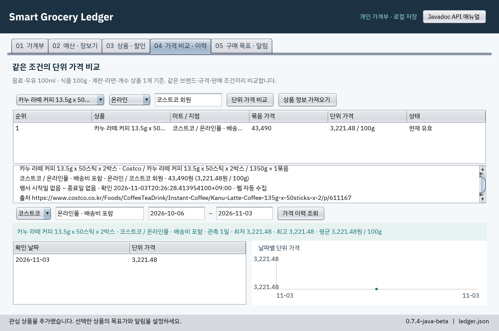

# Smart Grocery Ledger

이번 달 식비가 얼마나 남았는지 확인하고, 장보기 전에 같은 규격의 상품을 단위 가격으로 비교하는 개인용 가계부입니다. Windows에서 실행한 예시는 아래와 같습니다.



## 처음 실행하기

Java 17 이상과 그래픽 화면이 필요합니다. 터미널에서 `java -version`으로 Java 버전을 확인하고 실행 파일을 내려받으세요. [SmartGroceryLedger.jar 다운로드](https://github.com/hyeonsu-test/smart-grocery-ledger/raw/refs/heads/main/SmartGroceryLedger.jar)

JAR를 저장한 폴더에서 다음 명령을 실행하면 가상의 거래와 가격이 들어 있는 시연 가계부가 열립니다.

```sh
java -jar SmartGroceryLedger.jar --demo
```

개인 가계부를 시작할 때는 다음 명령을 사용하세요.

```sh
java -jar SmartGroceryLedger.jar
```

## 우유 가격을 비교하고 장보기 계획에 넣기

1. **상품 · 할인**에서 우유를 선택하면 마트, 지점, 용량, 묶음 수, 가격을 확인한 시각과 출처를 볼 수 있습니다.
2. **가격 비교 · 이력**에서 우유와 판매 조건을 고르고 **단위 가격 비교**를 누르세요. 1L에 2,600원인 우유는 100ml당 260원입니다. 같은 조건에서 어느 마트가 저렴한지 확인할 수 있습니다.
3. **상품 · 할인**으로 돌아가 원하는 상품을 선택하고 **장보기 추가**를 누르세요. **예산 · 장보기**에서 수량을 바꾸면 **항목 적용** 후 **계획 저장**을 누릅니다. 가격을 알 수 없는 항목이 있으면 확인된 소계와 미확정 항목 수를 따로 보여 줍니다.
4. 구매 후에는 **상품 · 할인 → 실제 구매 기록**에서 결제 총액을 입력하고 **내역 저장**을 누르세요. 이때 가계부의 실제 지출과 월 잔액이 바뀝니다.

즐겨찾기에 추가한 상품은 **구매 목표 · 알림**에서 목표가를 설정할 수 있습니다. 개인 목표가를 비우면 직전 28일 중 가격을 관측한 날짜의 평균을 구하고 그 값의 90%를 기준으로 삼습니다. 기준을 계산하려면 서로 다른 날짜의 관측값이 4일 이상 필요합니다. 앱을 실행하는 동안 목표를 충족하면 상품별로 하루 한 번 알립니다.

## 내 가격과 가계부 관리하기

- **가격을 추가할 때**는 **상품 · 할인 → 가격 직접 입력**을 사용하세요. 파일로 가져오려면 **JSON 피드 연결**에서 마트와 로컬 파일을 선택한 뒤 **연결 피드 갱신**을 누르세요. 이 버전에서 제공하는 가격 출처는 직접 입력과 로컬 JSON입니다. [피드 파일 예시](resources/feed-example.json)
- **가격이 비교 목록에 없을 때**는 확인 시각과 행사 기간을 확인하세요. 확인 후 24시간이 지난 가격은 현재 비교에서 제외됩니다. 배송비는 비교 가격에서 제외되므로 실제 지출에는 영수증의 결제 총액을 입력하세요.
- **내 자료를 보관할 때**는 사용자 홈의 `SmartGroceryLedger/data` 폴더를 확인하세요. 개인 가계부는 `ledger.json`, 시연 가계부는 `demo.json`입니다. 앱을 닫은 뒤 해당 파일을 복사해 백업할 수 있습니다.
- **새 시연 자료가 필요할 때**는 새 폴더 이름을 지정해 `java -jar SmartGroceryLedger.jar --demo --data-dir "./demo-new"`로 실행하세요. 시연 가격은 시연 가계부를 처음 만드는 날짜를 기준으로 생성됩니다.

현재 버전은 **0.4.2-java-beta**입니다. 소스에서 빌드하거나 서비스 API를 살펴보려면 아래 문서를 이용하세요.

- [빌드, 테스트 및 플랫폼별 실행 결과](doc/verification.md)
- [객체 구조와 클래스 다이어그램](doc/architecture.md)
- 앱 상단의 **Javadoc API 매뉴얼** 버튼에서 클래스별 메서드와 입력·반환값을 볼 수 있습니다.
